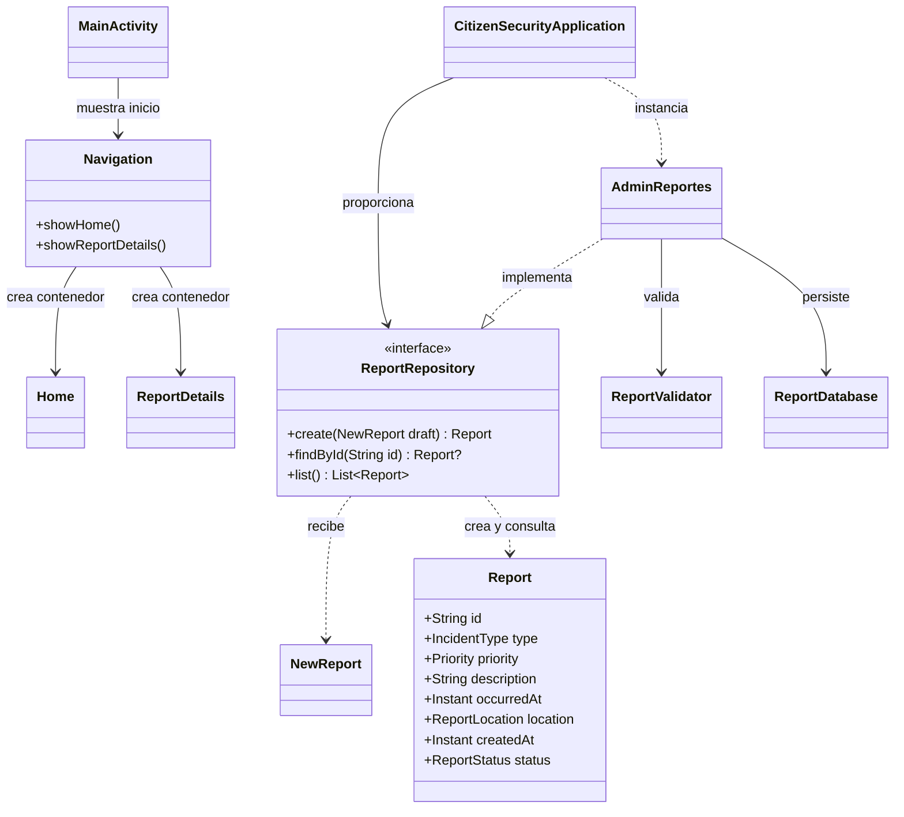

# Estructura de la base 0.1.0-rev.2-beta

**13 de noviembre de 2026.** Esta revisión convierte la organización del pizarrón en archivos reales del código inicial. Parte del commit `b4f80a8`, reúne sus módulos en `app` y mantiene la función de validación y persistencia local.

[ESTRUCTURA_INICIAL.md](ESTRUCTURA_INICIAL.md) explica el corte histórico 0.1.0: allí navegación y pantallas eran trabajo previsto, y la implementación SQLite se llamaba `SqliteReportRepository`. Este documento describe el código reorganizado de la beta.

## Archivos y responsabilidades

```text
app/src/main/
├── kotlin/com/example/citizensecurity/
│   ├── MainActivity.kt
│   ├── CitizenSecurityApplication.kt
│   ├── navigation/
│   │   └── Navigation.kt
│   ├── screen/
│   │   ├── Home.kt
│   │   └── ReportDetails.kt
│   └── data/
│       ├── Report.kt
│       ├── ReportRepository.kt
│       ├── ReportValidator.kt
│       ├── AdminReportes.kt
│       └── ReportDatabase.kt
└── res/layout/activity_main.xml
```

| Parte | Responsabilidad en esta revisión |
| --- | --- |
| `MainActivity` | Carga el contenedor XML y solicita mostrar `Home`. |
| `CitizenSecurityApplication` | Proporciona una instancia compartida de `ReportRepository`, creada mediante `AdminReportes` cuando se necesita. |
| `Navigation` | Sustituye el contenido del contenedor por `Home` o `ReportDetails`. |
| `Home` y `ReportDetails` | Reservan los contenedores vacíos de inicio y detalle para desarrollar su interfaz. |
| `Report.kt` | Define `NewReport`, `Report`, `ReportLocation` y sus enumeraciones. |
| `ReportRepository` | Define las operaciones suspendidas `create`, `findById` y `list`. |
| `ReportValidator` | Comprueba texto, fecha y ubicación. |
| `AdminReportes` | Implementa el contrato, normaliza y valida antes de guardar, y consulta SQLite. |
| `ReportDatabase` | Crea el esquema SQLite versión 1. |

Las pantallas todavía no contienen lista, detalle de un reporte, campos, botones ni acceso a datos. La ruta de detalle se puede invocar desde código; no hay un control visual para abrirla. Iniciar la aplicación no crea reportes de demostración ni abre la base por iniciativa de una pantalla.

## Diagrama de clases



Las tres operaciones del contrato son `suspend` en Kotlin; se omite ese modificador en el dibujo para facilitar la lectura. `AdminReportes` es un gestor de datos, no un usuario con permisos especiales. La beta conserva crear, buscar y listar; no incorpora editar ni borrar.

## Recorrido de los datos

1. El código que conecte la futura interfaz construirá un `NewReport`.
2. Obtendrá `CitizenSecurityApplication.reportRepository` y llamará a `create` desde una corrutina.
3. `AdminReportes` normalizará el texto y usará `ReportValidator` para comprobarlo.
4. Un borrador válido se guardará en una transacción y devolverá un `Report` con UUID, fecha de creación y estado `REPORTED`.
5. `findById` y `list` permitirán consultar los registros del archivo local.

Ese recorrido de datos ya existe en el contrato y sus clases. Su conexión con formularios y controles visuales sigue pendiente. Las reglas completas están en [Guardar reporte](GUARDAR_REPORTE.md).

## Guion breve para presentar

> Partimos de la base inicial de CitizenSecurity y organizamos sus archivos como en el pizarrón: una actividad de entrada, navegación, pantallas y datos. Ahora esos nombres existen en el proyecto. Inicio y detalle siguen vacíos para trabajar después la interfaz. En datos, Report representa el incidente y AdminReportes implementa el contrato para validar, guardar y consultar en SQLite. Conservamos las reglas de la primera entrega y todavía no añadimos edición, borrado ni funciones posteriores.

La revisión se identifica como `0.1.0-rev.2-beta`, usa el nombre de instalación **CitizenSecurity Base beta** y está preparada para publicarse como prerelease separada de la versión oficial 0.7. La [validación](VALIDACION.md) distingue los resultados históricos de los de esta revisión.

[Volver al README](../README.md).
