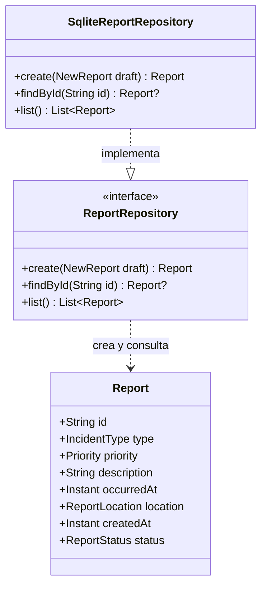

# CitizenSecurity: estructura del primer desarrollo

**Presentación de la base 0.1.0 · organizada el 13 de noviembre de 2026.** Referencia histórica: commit `b4f80a8dfad9737b4cb4c7f257749065e71fb292`, del 2 de octubre. La primera etiqueta, `v0.2.0`, conserva las mismas fuentes productivas. Esta presentación se limita al inicio del proyecto.

## Objetivo inicial

Registrar información de un incidente, validar sus datos, guardarla en el teléfono y consultarla después por folio o en una lista.

## Organización del desarrollo según el pizarrón

```text
CitizenSecurity
├── MainActivity                 Entrada de la aplicación
├── navigation
│   └── Navigation               Recorrido entre pantallas
├── screen
│   ├── Home                     Inicio y lista de reportes
│   └── ReportDetails            Información de un reporte
└── data
    ├── Report                   Modelo del reporte
    └── AdminReportes            Responsabilidad de guardar y consultar
```

Este árbol organiza las responsabilidades para explicar el desarrollo. En el corte 0.1.0, `MainActivity` tenía un contenedor visual vacío: `Navigation`, `Home` y `ReportDetails` eran partes por desarrollar, no archivos o pantallas terminados. `AdminReportes` es el nombre explicativo del gestor; en el código su responsabilidad se divide entre `ReportRepository` y `SqliteReportRepository`.

| Parte | Responsabilidad | Ubicación real en la base inicial |
| --- | --- | --- |
| Entrada | Cargar el contenedor de la interfaz | `app`: `MainActivity.kt` y `activity_main.xml` |
| Navegación y pantallas | Conectar inicio y detalle | Trabajo visual previsto para el compañero |
| Modelo | Representar los datos del incidente | `core/domain`: `Report.kt`, con `NewReport`, `Report` y `ReportLocation` |
| Gestor | Definir guardar, buscar y listar | `core/domain`: `ReportRepository.kt` |
| Validación | Comprobar descripción, fecha y ubicación | `core/domain`: `ReportValidator.kt` |
| Almacenamiento | Ejecutar las operaciones en SQLite | `core/data`: `SqliteReportRepository.kt` y `ReportDatabase.kt` |

## Diagrama de clases del primer corte



`NewReport` contiene la información recibida antes de guardar. Al crear el registro se obtiene un `Report` con folio, fecha de creación y estado inicial `REPORTED`. `ReportLocation` reúne referencia escrita y coordenadas opcionales. `suspend` se omite en las firmas del dibujo para simplificar su lectura; las tres operaciones del contrato lo usan en Kotlin.

El “administrador” del ejemplo del pizarrón administra los datos; no representa un usuario con permisos especiales. En esta base se implementaron **crear, buscar y listar**. Editar y borrar no formaban parte de su contrato inicial.

## Recorrido básico

1. Recibir tipo, descripción, prioridad, fecha y ubicación en un `NewReport`.
2. Validar texto, fecha y coordenadas mediante `ReportValidator`.
3. Guardar en una transacción SQLite y generar un folio UUID.
4. Consultar el reporte por folio o listar los guardados por fecha de creación.

El mapa visual, las fotografías, las cuentas, los contactos y las funciones posteriores pertenecen a otros incrementos. La base inicial almacenaba información local.

## Explicación breve para presentar

> CitizenSecurity comenzó con una estructura separada en entrada y pantallas, reglas del reporte y almacenamiento. El modelo representa los datos del incidente; el gestor define cómo guardarlos y consultarlos; la implementación utiliza SQLite. En el primer corte construimos el modelo, la validación y la persistencia, y dejamos el contenedor preparado para que el compañero desarrollara la interfaz y la navegación. El trabajo posterior amplió esa base por funciones.

## Código de referencia del corte

- [MainActivity inicial](https://github.com/Spidey123134/citizensecurity/blob/b4f80a8dfad9737b4cb4c7f257749065e71fb292/app/src/main/kotlin/com/example/citizensecurity/MainActivity.kt).
- [Modelos iniciales](https://github.com/Spidey123134/citizensecurity/blob/b4f80a8dfad9737b4cb4c7f257749065e71fb292/core/domain/src/main/kotlin/com/example/citizensecurity/domain/Report.kt).
- [Contrato del gestor inicial](https://github.com/Spidey123134/citizensecurity/blob/b4f80a8dfad9737b4cb4c7f257749065e71fb292/core/domain/src/main/kotlin/com/example/citizensecurity/domain/ReportRepository.kt).

[Volver al proyecto](../README.md) · [Código reorganizado de la revisión beta](ESTRUCTURA_BETA.md).
